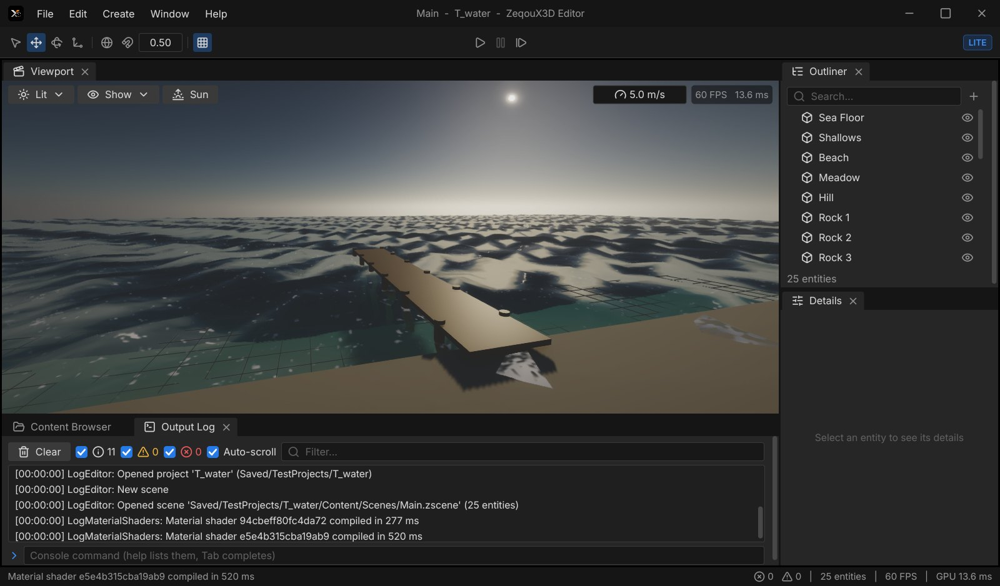
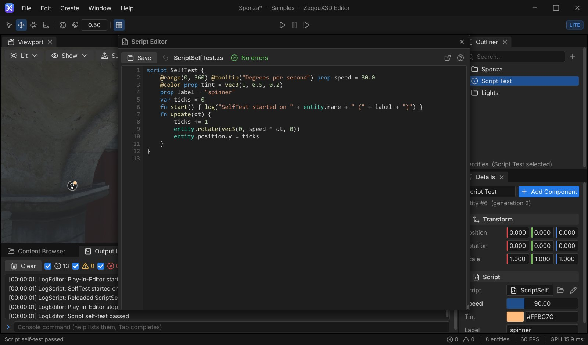
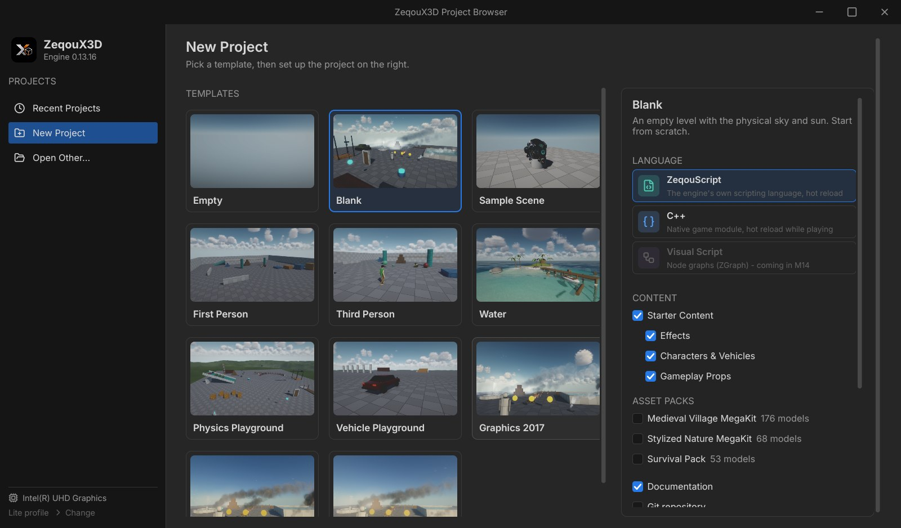
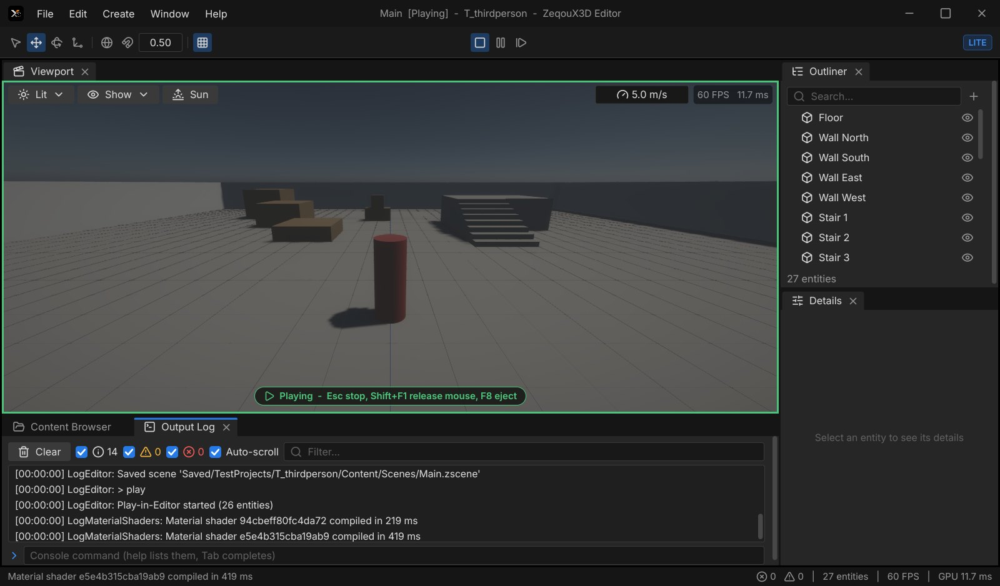
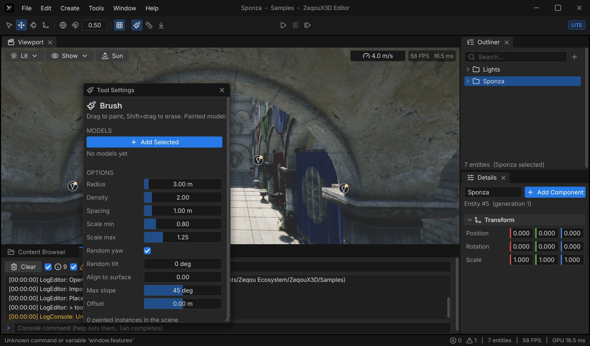
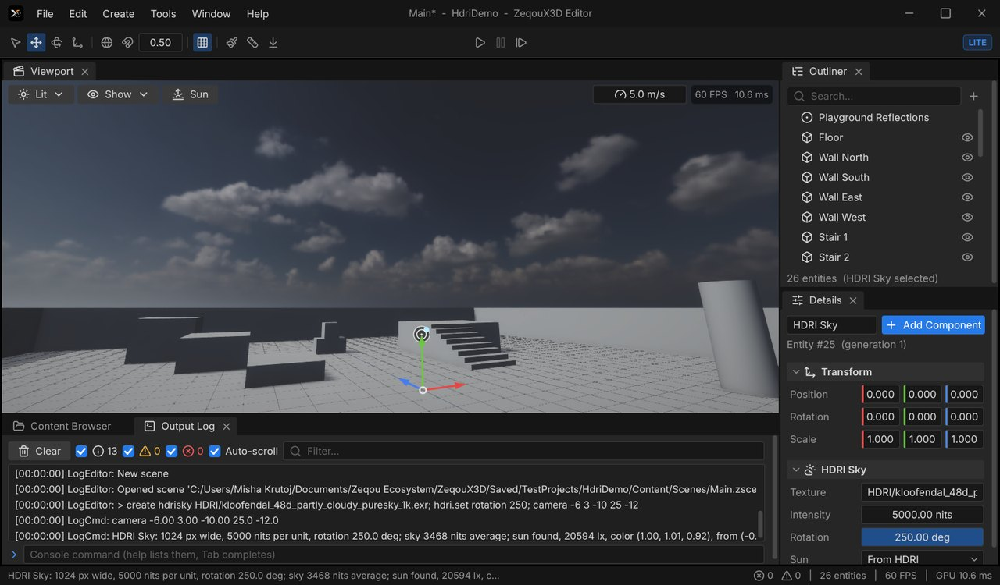
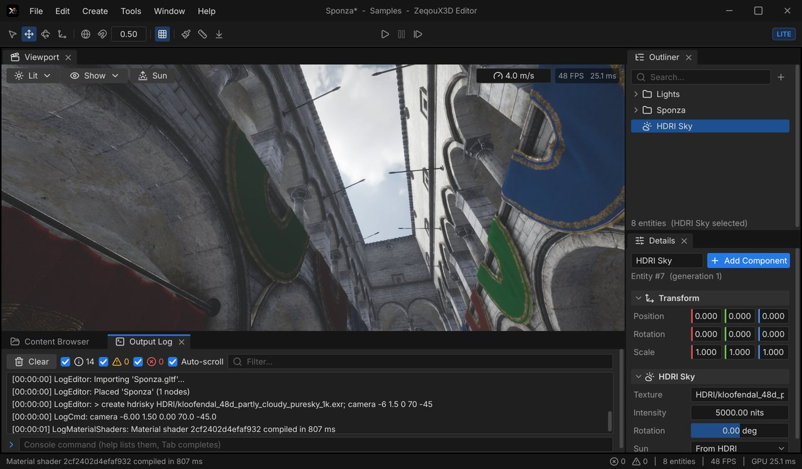
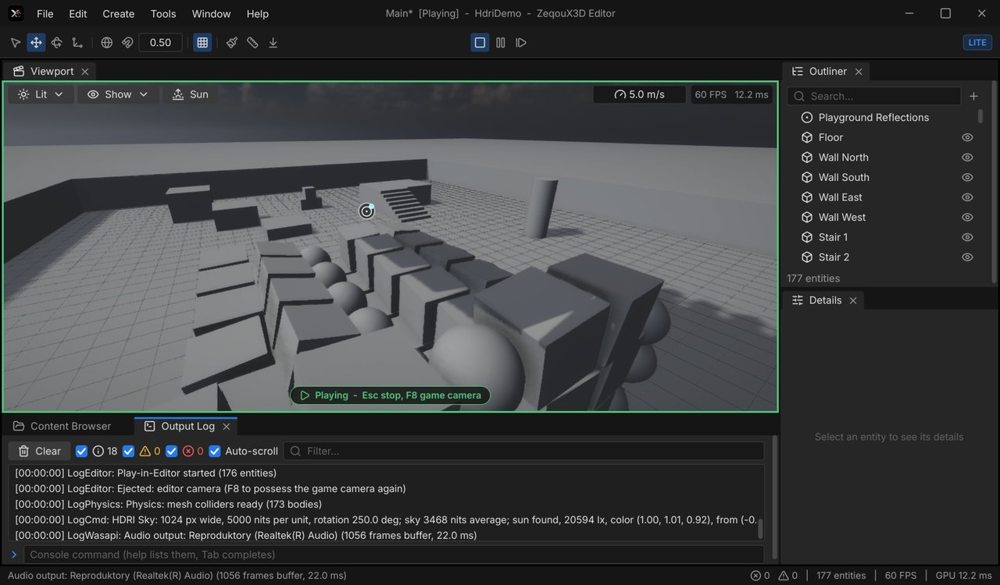
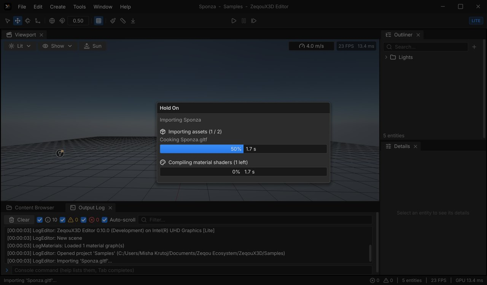

# ZeqouX3D

A 3D game engine and editor written from scratch in C++20 on Direct3D 12 — part of the
[Zeqou](https://mishaadevv.github.io/zeqou/) ecosystem. The goal is a Unity URP / Unreal Engine 5 style workflow that runs
well on everyday hardware (the development machine is a laptop with Intel UHD 620 graphics).

**Version 0.10.2** · zero third-party libraries (only Windows and its SDK) · [changelog](docs/CHANGELOG.md)



## What's inside

- **Renderer** — Direct3D 12 with bindless resources and a render graph; clustered forward+ PBR, cascaded and local
  shadows, GTAO, physical sky with height fog or an HDRI sky (its sun becomes the directional light), sky and
  reflection-probe image-based lighting, screen-space reflections, decals, TAA with ZTSR temporal upscaling and dynamic
  resolution, bloom, auto exposure, ACES tonemapping, depth of field, camera motion blur, blended Post Process Volumes;
  Lite/Full profiles chosen by hardware.
- **Assets** — own importers for glTF/GLB, OBJ, PNG, JPEG, TGA, BMP, Radiance HDR, OpenEXR (PIZ/ZIP/RLE/PXR24, scanline
  and tiled), DDS, WAV, Ogg Vorbis, TTF/WOFF, SVG; own BC1/BC3/BC4/BC5, BC7 and BC6H (HDR) encoders; cooked data cache.
- **Physics (ZPhys)** — own rigid-body engine: boxes, spheres, capsules, static triangle meshes and compounds, dynamic
  AABB trees, SAT contact clipping, a soft-step solver with substeps (stable stacks), friction, bounce, sleeping
  islands, raycasts; Unity-style Rigid Body and Collider components in the editor.
- **Realistic water** — Gerstner waves, Fresnel sky reflection, sun glints, refraction, depth absorption and foam.
- **Audio** — own 48 kHz mixer on WASAPI with buses, ducking, snapshots, reverb and a limiter; 3D sound with
  attenuation, panning, cones, Doppler and raycast occlusion; own WAV/ADPCM and Ogg Vorbis decoders, streamed music.
- **Editor** — dockable UE5/Unity-style shell (own immediate-mode UI with SDF text): viewport with gizmos, outliner,
  details, content browser, output log with console, command palette, undo/redo for everything.
- **Projects** — Project Browser with templates (Blank, Sample Scene, First Person, Third Person, Water), Starter Content,
  generated documentation for people and AI assistants (`AGENTS.md`), optional Git repository.
- **ZeqouScript** — the engine's own scripting language: compiled to bytecode, hot reload while playing, `prop` fields
  edited per entity in the Details panel, built-in Script Editor with syntax colors and live errors.
  Reference: [docs/ZeqouScript.md](docs/ZeqouScript.md).
- **C++ gameplay** — a project's game module (`Source/<Name>`) built in the background and hot-reloaded while the
  game is playing (props kept); components from a single-header Game SDK, edited per entity in Details.
- **Input Actions** — named buttons and axes bound to keyboard, mouse and gamepad, used by scripts and C++.
- **Gameplay** — Play-in-Editor with the game camera and input capture, Character Controller (walking, stairs, jumping),
  prefabs with overrides, material graphs with a node editor.
- **Tools** — Brush (paint models onto surfaces), Measure, Drop to Ground, per-project Features toggles.

| Script Editor | Project Browser |
|---|---|
|  |  |
| **Third Person template** | **Brush tool** |
|  |  |
| **HDRI Sky (OpenEXR panorama, its sun casts the shadows)** | **HDRI Sky over Sponza** |
|  |  |
| **Physics: 150 rigid bodies falling into the First Person playground** | **Progress window** |
|  |  |

## Building

Requirements: Windows 10/11, Visual Studio 2022 Build Tools (C++ workload, CMake, Ninja), Windows SDK 10.0.26100+.

```powershell
powershell -ExecutionPolicy Bypass -File Tools/build.ps1 -Config Development        # build
powershell -ExecutionPolicy Bypass -File Tools/build.ps1 -Config Debug -Test         # build + tests
powershell -ExecutionPolicy Bypass -File Tools/fetch_samples.ps1                     # optional samples (Sponza, an HDRI, ...)
```

Binaries go to `Binaries/Win64/<Debug|Development|Shipping>/`: `ZXEditor.exe` (the editor), `ZXTests.exe` (tests),
`MeshViewer.exe` and `UIDemo.exe` (samples).

## Repository layout

| Path | Contents |
|---|---|
| `Engine/Source/Runtime` | Engine modules: Core, Platform, RHI, RHI_D3D12, Asset, Scene, Render, Script, Audio, Engine, UI |
| `Engine/Source/Programs/ZXEditor` | The editor |
| `Engine/Shaders` | HLSL shaders (compiled with DXC at runtime) |
| `Engine/Content` | Fonts, icons, branding |
| `Samples`, `Tests` | Sample programs and the test runner |
| `docs` | Specification and roadmap (`TZ.md`, Russian), changelog, ZeqouScript reference |

## License

[PolyForm Strict 1.0.0](LICENSE) — free for noncommercial use. Fonts: Inter (SIL OFL 1.1) and Lucide (ISC), see their
`LICENSE.txt` files in `Engine/Content/Fonts`.
