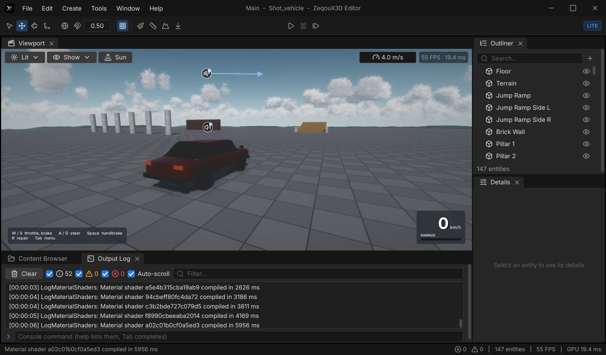
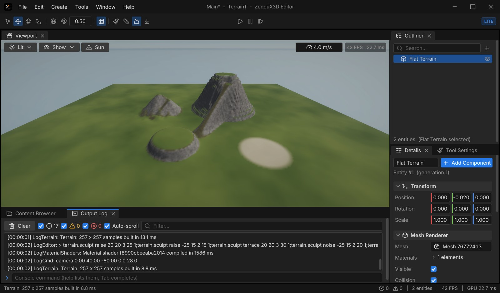
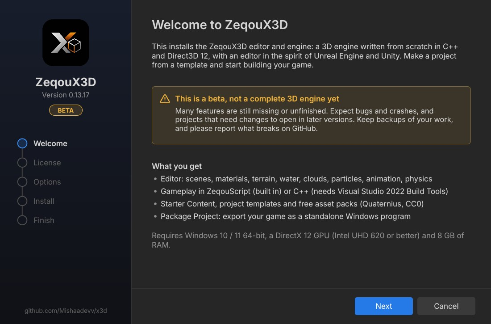

# ZeqouX3D

A 3D game engine and editor written from scratch in C++20 on Direct3D 12, part of the
[Zeqou](https://mishaadevv.github.io/zeqou/) ecosystem. The goal is a workflow like Unity URP or Unreal Engine 5 that
runs well on everyday hardware. The development machine is a laptop with Intel UHD 620 graphics.

**Version 0.13.17 (Beta)** · no third-party libraries (only Windows and its SDK) · [changelog](docs/CHANGELOG.md) ·
[download](https://github.com/Mishaadevv/x3d/releases/latest)

> [!WARNING]
> **ZeqouX3D is in beta and is not a complete 3D engine yet.** Many features are missing or unfinished. Expect bugs and
> crashes, and projects made with one version may need changes to open in later ones. Keep backups of your work.


## Download

Get the latest build from [Releases](https://github.com/Mishaadevv/x3d/releases/latest):

- **ZeqouX3D-&lt;version&gt;-Beta-Setup.exe**: the installer. It installs for your user account with no administrator
  rights, adds Start menu and desktop shortcuts, and uninstalls from *Apps & features*.
- **ZeqouX3D-&lt;version&gt;-Beta-Portable.zip**: the same files. Unpack anywhere and run `Binaries/Win64/ZXEditor.exe`.

**Requirements:** Windows 10 / 11 64-bit, a DirectX 12 GPU (Intel UHD 620 or better), 8 GB RAM.

- Gameplay in ZeqouScript works out of the box.
- C++ game code also needs Visual Studio 2022 Build Tools with the C++ workload.

The installer isn't code-signed yet, so Windows SmartScreen may warn about it. Click *More info → Run anyway*.

Bug reports are welcome in [Issues](https://github.com/Mishaadevv/x3d/issues). Please attach the log from `Saved/Logs`.

## Getting started

1. Start **ZeqouX3D Editor** and choose **New Project**.
2. Pick a template: Empty, First Person, Third Person, Water, Physics Playground, Vehicle Playground, or one of the
   Graphics 2017 / 2011 / 2008 looks. Asset packs can be added to the project.
3. Press **Play** to try it in the editor. Add Script components (ZeqouScript) or a C++ game module for gameplay.
4. Use **File → Package Project** to export a standalone Windows game you can share.

## What's inside

### Rendering
- **Renderer**: Direct3D 12 with bindless resources and a render graph, plus a GPU-driven path (GPU culling, Hi-Z
  occlusion, ExecuteIndirect).
  - Clustered forward+ and deferred PBR.
  - Cascaded shadows with PCSS, contact shadows, GTAO.
  - Screen-space reflections, reflection probes, decals.
  - TAA with temporal upscaling and dynamic resolution, bloom, auto exposure, depth of field, motion blur, color LUTs,
    Post Process Volumes.
  - Lite / Full profiles chosen by the hardware.
  - "Graphics era" presets (2017 / 2011 / 2008) for a retro look.
- **Sky and weather**:
  - A physical sky or an HDRI sky.
  - Volumetric clouds with presets and cloud shadows.
  - Height fog, volumetric fog and light shafts.
  - Wind that moves particles, water, cloth-like drag and bodies.
- **Water**:
  - An FFT ocean with foam, caustics and screen-space reflections.
  - An underwater view.
  - Buoyancy and splashes.
- **Effects**:
  - CPU and GPU particles (hundreds of thousands of sparks), flipbooks.
  - Fire that spreads and chars surfaces.
  - Simulated smoke and fire volumes.

### World and gameplay
- **Terrain**:
  - Generated hills, or flat ground to start from.
  - A sculpt brush: raise, lower, smooth, flatten, set height, ramp, terrace, erode, noise.
  - Painted layers (grass, rock, dirt, sand), paint by slope, heightmap import and export.
  - Collisions with physics.
- **Physics (ZPhys)**, an engine of its own:
  - Rigid bodies, convex hulls, meshes, height fields and joints.
  - Triggers, queries and collision events.
  - Characters with stairs and slopes.
  - Soft-body vehicles in the style of BeamNG.drive.
- **Animation**:
  - glTF skins and clips with GPU skinning.
  - AnimGraph state machines with layers, masks and blend spaces.
  - Foot IK, root motion and morph targets.
  - An Animation Viewer and an AnimGraph editor.
- **Audio**: its own mixer on WASAPI.
  - 3D sound, reverb zones and occlusion.
  - Footsteps by surface, Ogg Vorbis streaming.
- **Game UI**: HUD and menus.
  - Buttons, sliders, toggles, progress bars, input fields, scroll views.
  - World-space panels.
- **Scripting**:
  - **ZeqouScript**, the engine's own language, with hot reload while playing ([reference](docs/ZeqouScript.md)).
  - **C++ game modules** with hot reload and a single-header Game SDK.
  - Input Actions for keyboard, mouse and gamepad.

### Editor
- A dockable shell in the style of UE5 and Unity: viewport with gizmos, outliner, details, content browser, output
  log with a console, command palette.
- Undo / redo for everything.
- Prefabs with overrides, material graphs with a node editor, Play-in-Editor.
- Tools: Terrain, Brush (paint models onto surfaces), Measure, Drop to Ground.
- Settings window.
- Project Browser with templates, Starter Content and free CC0 asset packs (Quaternius).
- **Package Project**: cooks the game into a `.zpak` and exports a standalone `.exe`.
- Its own importers and codecs:
  - Models: glTF/GLB, OBJ.
  - Images: PNG, JPEG, TGA, BMP, HDR, OpenEXR, DDS.
  - Audio: WAV, Ogg Vorbis.
  - Fonts and vector art: TTF/WOFF, SVG.
  - Texture compression: BC1–BC7 / BC6H encoders.

| Vehicle Playground (soft-body car) | Third Person template |
|---|---|
|  |  |
| **Terrain tool on a Flat Terrain** | **Physics Playground** |
|  |  |
| **New Project** | **Installer** |
|  |  |
| **Script Editor** | **HDRI Sky over Sponza** |
|  |  |

## Building from source

**Requirements:** Windows 10/11, Visual Studio 2022 Build Tools (C++ workload, CMake, Ninja), Windows SDK 10.0.26100+.

```powershell
powershell -ExecutionPolicy Bypass -File Tools/build.ps1 -Config Development        # build
powershell -ExecutionPolicy Bypass -File Tools/build.ps1 -Config Debug -Test         # build + tests
powershell -ExecutionPolicy Bypass -File Tools/fetch_samples.ps1                     # optional samples (Sponza, an HDRI, ...)
powershell -ExecutionPolicy Bypass -File Tools/make_release.ps1                      # Shipping build + installer + portable zip
```

Binaries go to `Binaries/Win64/<Debug|Development|Shipping>/`:

| Program | What it is |
|---|---|
| `ZXEditor.exe` | The editor |
| `ZXGame.exe` | The runtime of packaged games |
| `ZXSetup.exe` | The installer builder |
| `ZXTests.exe` | 400+ tests |
| `MeshViewer.exe`, `UIDemo.exe` | Samples |

## Repository layout

| Path | Contents |
|---|---|
| `Engine/Source/Runtime` | Engine modules: Core, Platform, RHI, RHI_D3D12, Asset, Scene, Render, Physics, Script, Audio, Engine, UI |
| `Engine/Source/Programs` | `ZXEditor` (the editor), `ZXGame` (packaged game runtime), `ZXSetup` (installer) |
| `Engine/Source/GameSDK` | Single-header SDK for C++ game modules |
| `Engine/Shaders` | HLSL shaders (compiled with DXC at runtime) |
| `Engine/Content` | Fonts, icons, Starter Content, templates, asset packs |
| `Samples`, `Tests` | Sample programs and the test runner |
| `Tools` | Build, release and content scripts |
| `docs` | Specification and roadmap (`TZ.md`, Russian), changelog, ZeqouScript reference |

## License

**ZeqouX3D License** ([LICENSE](LICENSE)): the PolyForm Strict License 1.0.0 with a **Game Exception**.

- **You can:** use ZeqouX3D for free to make games, and give away or sell those games anywhere, with no royalties. A
  packaged game may include the engine runtime and content that *Package Project* puts into it. Your own content and
  code are yours.
- **You can't:** redistribute, modify or resell the engine, the editor or their source code themselves, or build
  another engine or tool from them.

Third-party parts keep their own licenses:

- Inter (SIL OFL 1.1) and Lucide (ISC) fonts in `Engine/Content/Fonts`.
- Quaternius asset packs (CC0) in `Engine/Content/Packs`.
- DirectX Shader Compiler (Microsoft, Windows SDK).
